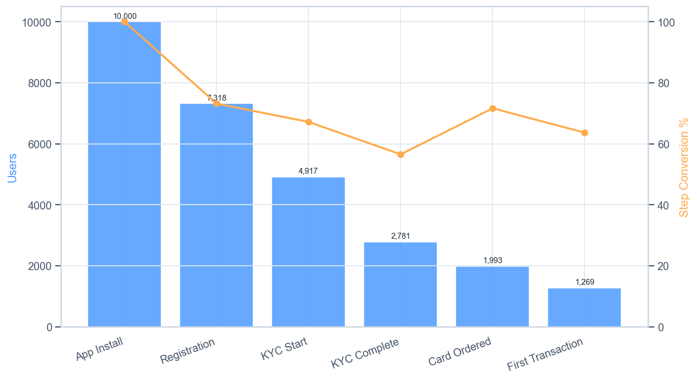
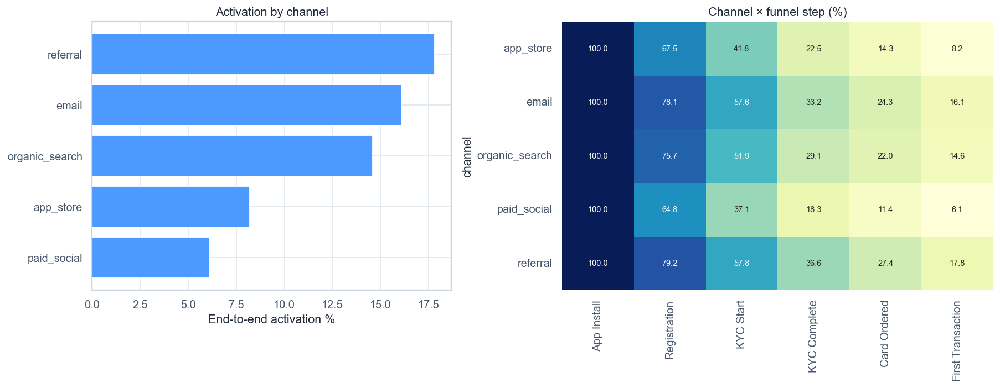
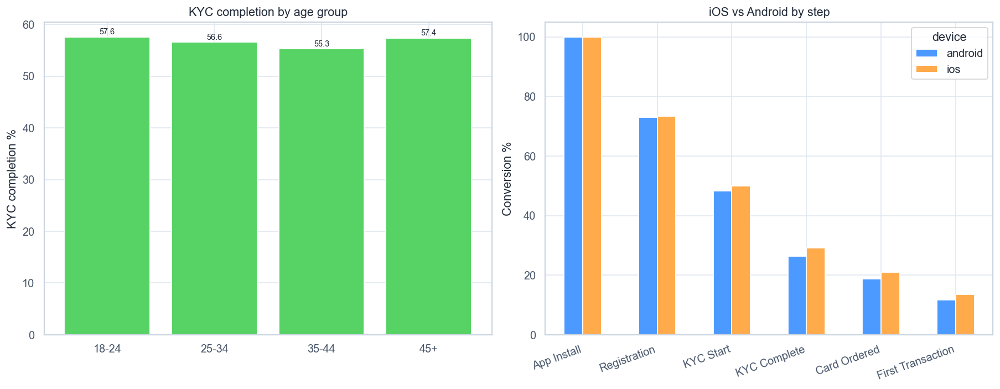
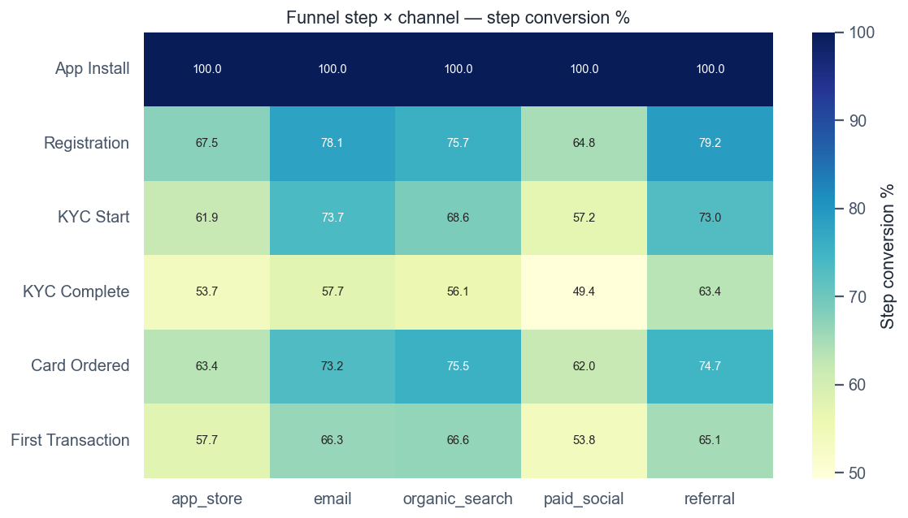

# Volta — Funnel Analysis

[](https://github.com/NikitaBoyarkin/case-funnel/actions/workflows/ci.yml)

[](LICENSE)

The neobank onboarding funnel: KYC is the bottleneck at 56.6% step conversion, registration loses the most in absolute terms (2,682). Broken down by channel and platform.

## Key results

- KYC Complete — largest relative drop-off (56.6%)
- Registration — largest absolute loss (2,682, 73.2%)
- Referral +11.7pp over paid social; iOS 13.6% vs Android 11.7%

## Situation

The first project in the **discover** loop: find where the fictional neobank «Volta» loses users in onboarding. Data is synthetic, seeded generator → reproducible CSV.

## Task

My job was to open the discover loop by locating exactly where onboarding loses users, working on a synthetic dataset built for reproducible runs.

## Actions

- Step conversion and absolute/relative drop-off at each funnel step (Install → Registration → KYC → Card → First TX).
- Chi-square test for acquisition-channel differences.
- Platform (iOS vs Android) and channel (referral vs paid social) comparison at each step.

## Result

- **KYC Complete** — largest relative drop-off: **56.6% step conversion** (2,781 of 4,917).
- **Registration** — largest absolute loss: **2,682 users, 73.2% step conv**.
- **Referral** converts **+11.7pp** better than paid social; **iOS** beats Android (**13.6% vs 11.7%**).
- Only **1,269 of 10,000** reach the first transaction (12.7%) — the funnel loses ~87%.

## Recommendations

- Rework the KYC UX — progress bar (validated in Project 2), real-time photo hints.
- Simplify registration — A/B test on removing the phone field (largest absolute loss).
- Strengthen referral and reallocate 15% of the paid-social budget.
- Run an Android sprint — QA audit to close the gap with iOS.

## Charts










> # Onboarding Funnel — Absolute User Drop-off
>
> 
>
> *Каждый столбец показывает, сколько пользователей теряется между двумя соседними шагами воронки онбординга.*
>
> ## Выводы
>
> - Переход «App Install → Registration» теряет больше всего пользователей в абсолютных числах (2 682).
> - У шага KYC Complete самая низкая конверсия шага (56,6%) — главное относительное узкое место.
> - Только 1 269 из 10 000 установок (12,7%) доходят до первой транзакции.
> - Приоритет: сначала починить KYC UX (максимальный относительный провал), затем упростить этап с наибольшей абсолютной потерей.
>
> ---
> <sub>Источник: `scripts/volta_funnel_analysis.py` · данные: `data/volta_funnel_data.csv`</sub>

## Dataset

The dataset is fully synthetic, generated by seeded, reproducible script(s) (`scripts/generate_funnel_data.py`). No real customer data is used. Running `make data` regenerates the CSV(s) in `data/` with the same random seed, so every number below is reproducible.

## Quick start

```bash
uv sync --all-groups
make data
make run
```

## Project structure

```text
case-funnel/
├── README.md
├── LICENSE
├── .gitignore
├── .python-version
├── pyproject.toml
├── Makefile
├── .github/workflows/ci.yml
├── scripts/
│   ├── generate_funnel_data.py
│   └── volta_funnel_analysis.py
├── utils/
│   ├── __init__.py
│   ├── common.py
│   └── viz_helpers.py
├── data/
│   └── volta_funnel_data.csv
├── outputs/
│   ├── viz1_main_funnel.png
│   ├── viz2_channel_breakdown.png
│   ├── viz3_segments.png
│   ├── viz4_funnel_heatmap.png
│   ├── viz5_funnel_waterfall.png
└── tests/
    └── test_funnel.py
```

## Stack

- Python
- pandas / NumPy
- SciPy / Statsmodels
- scikit-learn
- Matplotlib / Seaborn
- uv + ruff

## Links

- [Full case study on the portfolio site](https://nikitaboyarkin.github.io/en/projects/volta/funnel/)
- [Parent project — volta-banking](https://github.com/NikitaBoyarkin/volta-banking)
